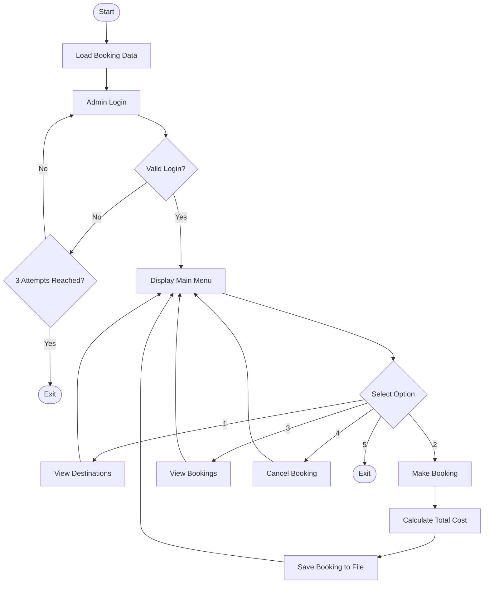
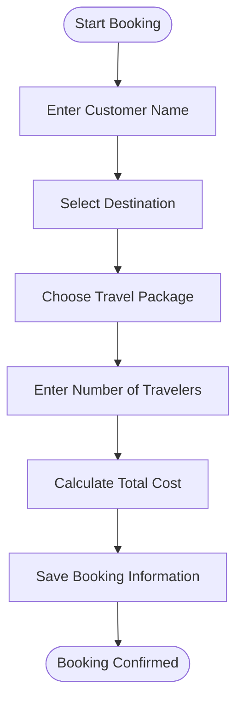
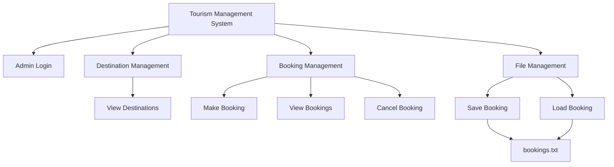

# Tourism-Management-System
Tourism Management System Project

**A C++ Based Tourism Management and Booking System**

## 1. Project Overview

Tourism Management System is a console-based application developed using C++. It helps users explore different tourist destinations, select travel packages, make bookings, view booking details, and cancel bookings.

The system includes an admin login system and file handling to store booking information.

## 2. Features

- Admin Login System
- View Available Destinations
- Display Destination Details
- Multiple Travel Packages
- Make New Bookings
- Automatic Total Cost Calculation
- View All Bookings
- Cancel Bookings
- Save Booking Information in a File
- Load Previous Booking Information

## 3. Available Destinations

| Destination | Description | Base Price |
|---|---|---:|
| Paris | City of Love | $1200 |
| Tokyo | Modern Metropolis | $1500 |
| Bali | Tropical Paradise | $800 |
| New York | The Big Apple | $1000 |
| Safari | African Adventure | $2000 |

## 4. Available Travel Packages

Each destination offers four different travel packages.

- **Paris:** Basic, Premium, Luxury, All-Inclusive
- **Tokyo:** Cultural, Adventure, Food Tour, Complete
- **Bali:** Beach, Nature, Spiritual, Family
- **New York:** City Tour, Shopping, Arts, Entertainment
- **Safari:** Wildlife, Camping, Photography, Expedition

## 5. System Flowchart

The following flowchart shows the overall working process of the Tourism Management System.

## 6. Booking Process Diagram

This diagram represents the steps involved in making a new booking.

## 7. System Structure Diagram

The system is divided into different functional modules.

## 8. Booking Cost Calculation

The total booking cost is calculated using the following formula:

**Total Cost = (Base Price + Package Premium) × Number of Travelers**

Each package upgrade adds $200 to the base price.

For example:

- Base Price = $800
- Package Premium = $200
- Number of Travelers = 2

Total Cost = (800 + 200) × 2 = **$2000**

## 9. File Handling

The system uses file handling to store and retrieve booking information.

- `bookings.txt` stores booking records.
- New bookings are saved using `ofstream`.
- Previous booking records are loaded using `ifstream`.
- Booking details are stored for future use.

## 10. Technologies Used

- Programming Language: C++
- Header Files: iostream, string, fstream, cstdlib, cstring
- Data Structures: Structures and Arrays
- File Handling: ifstream and ofstream
- Control Structures: Loops and Conditional Statements

## 11. Project File

- `TourismManagementSystem.cpp`
  
